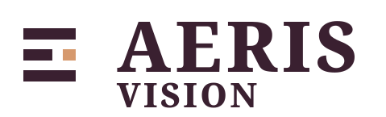
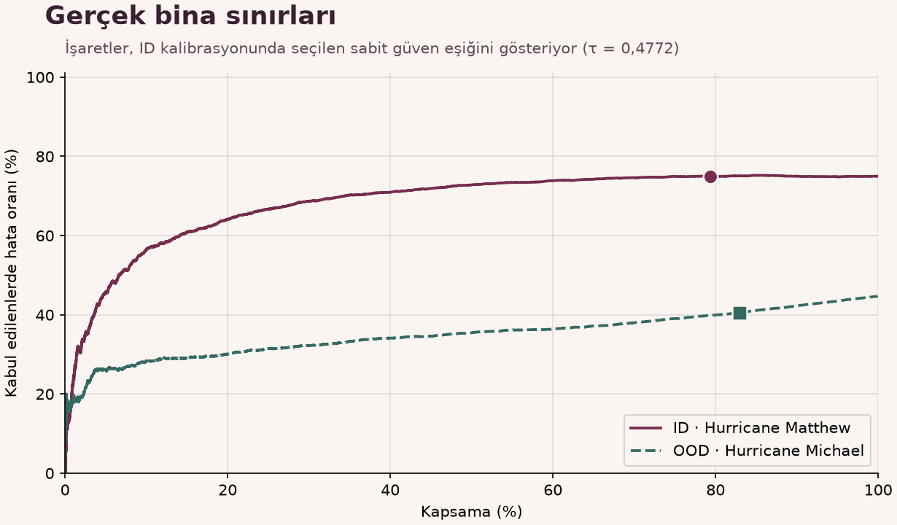
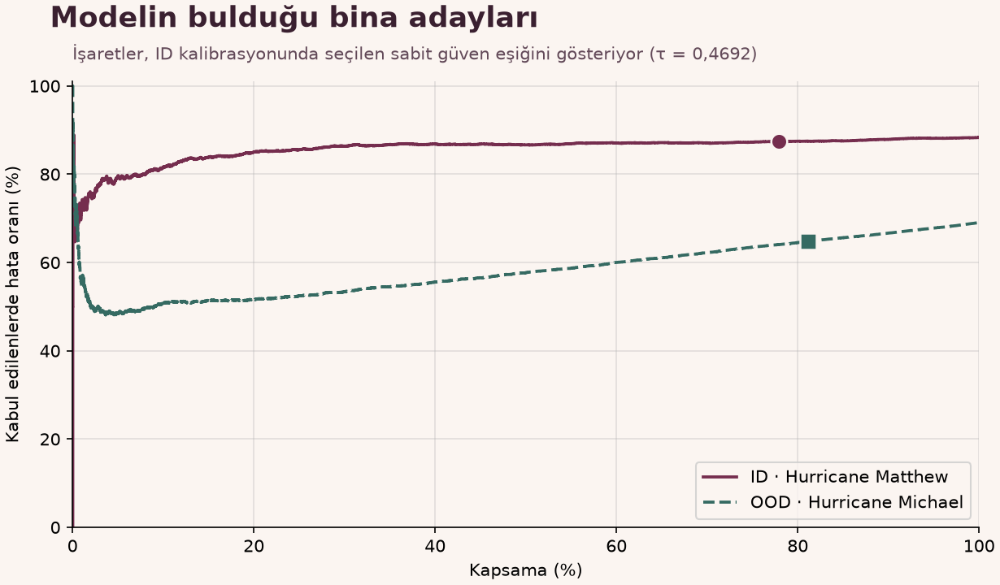
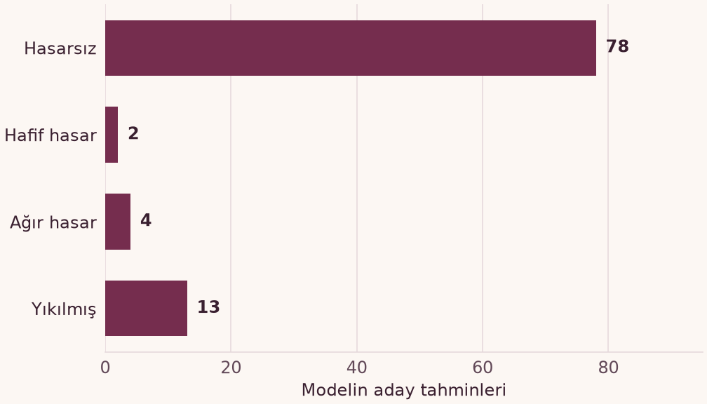
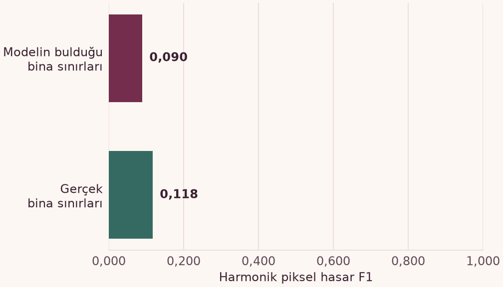

<picture>
  <source media="(prefers-color-scheme: dark)" srcset="site/public/brand/horizontal-reversed.svg">
  
</picture>

Afet sonrası bina hasarını uydu görüntülerinden incelemek için geliştirdiğim bir bilgisayarlı görü projesi. U-Net afet öncesi görüntüde bina adaylarını buluyor. ResNet18, adayların afet sonrası kırpımlarında dört hasar sınıfı için puan üretiyor.

[Proje günlüğü](https://vartmor.github.io/aeris-vision/) · [Galeri](https://vartmor.github.io/aeris-vision/galeri/) · [Deney raporu](docs/g4.md) · [Kurulum ve kullanım](docs/yerel-kullanim.md)

## Son deney

233 görüntülük kalibrasyon bölümünde iki güven eşiği seçtim. Dondurduğum eşikleri Hurricane Matthew’dan 223 görüntüde ve eğitimden tamamen ayırdığım Hurricane Michael’dan 343 görüntüde denedim. Kapsama, incelemeye ayırmadan kabul ettiğim tahminlerin oranı.

| Bina sınırları | Matthew kapsama | Matthew kabul edilenlerde hata | Michael kapsama | Michael kabul edilenlerde hata |
| --- | ---: | ---: | ---: | ---: |
| Gerçek sınırlar | %79,3 | %74,9 | %82,9 | %40,6 |
| Modelin bulduğu sınırlar | %77,9 | %87,4 | %81,1 | %64,8 |

Sabit eşikler iki testte de yaklaşık %80 kapsama sağladı. Kabul edilen tahminlerde hata yüksek kaldı. Sıcaklık ölçeklemesinden sonra her iki testte de ECE ve NLL yükseldi. [Deney yöntemi ve bina hata dökümü](docs/g4.md)

## Deney grafikleri

<!-- journal-gallery:start -->
<table>
<tr>
<td width="50%" valign="top">
  <a href="site/public/media/gunluk/06-gercek-bina-sinirlari.png"></a>
  <br><a href="https://vartmor.github.io/aeris-vision/galeri/?yazi=6">6. Güven eşiğini iki kasırgada denedim</a>
  <br>Her noktada kabul ettiğim bina oranı ve kabul edilenlerdeki hata görülüyor. İki işaret, testlerden önce seçtiğim aynı eşiği gösteriyor.
</td>
<td width="50%" valign="top">
  <a href="site/public/media/gunluk/06-modelin-bina-adaylari.png"></a>
  <br><a href="https://vartmor.github.io/aeris-vision/galeri/?yazi=6">6. Güven eşiğini iki kasırgada denedim</a>
  <br>Kapsama hesabına modelin ürettiği bütün adaylar girdi. İşaretler, adaylar için ayrı seçtiğim sabit eşiği gösteriyor.
</td>
</tr>
<tr>
<td width="50%" valign="top">
  <a href="site/public/media/gunluk/05-cpu-tahminleri.png"></a>
  <br><a href="https://vartmor.github.io/aeris-vision/galeri/?yazi=5">5. Çıkarım komutunu temiz bir kurulumda denedim</a>
  <br>Tek görüntü çiftinden gelen 97 adayın tahmin edilen sınıfları.
</td>
<td width="50%" valign="top">
  <a href="site/public/media/gunluk/05-hasar-f1.png"></a>
  <br><a href="https://vartmor.github.io/aeris-vision/galeri/?yazi=5">5. Çıkarım komutunu temiz bir kurulumda denedim</a>
  <br>Aynı 309 görüntü ve hedef maskelerle yaptığım iki ölçüm. Grafiğin ölçeği 0–1.
</td>
</tr>
</table>
<!-- journal-gallery:end -->

## Çalıştırma

Python 3.11 veya üzeri ve `uv` ile veri indirmeden aşağıdaki kontrolleri çalıştırabilirsin.

```sh
uv sync --locked
uv run --locked aeris --help
uv run --locked pytest
```

Veriyi hazırlama, modelleri eğitme ve kalibrasyon komutları yerel kullanım rehberinde. xBD verisini kendi hesabınla edinip `data/` altında tutabilirsin. [Yerel kullanım](docs/yerel-kullanim.md) · [xView2 veri koşulları](https://xview2.org/terms)

Site için Node.js 24 kullan.

```sh
cd site
npm ci
npm run dev
```

Yazılar ve grafikler `site/src/content/journal.ts` üzerinden güncellenir. Site galerisi aynı kayıttan üretilir. README grafik önizlemelerini yenilemek için `site/` dizininde `npm run readme:gallery` çalıştır. [Site ve yayın ayarları](site/README.md)
